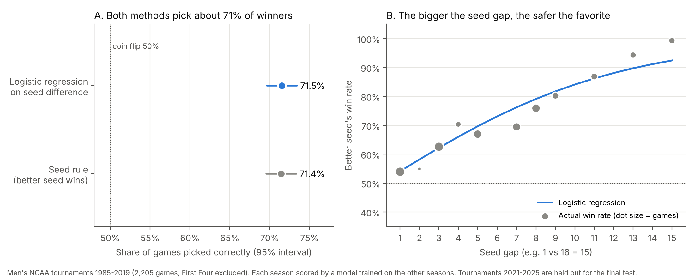

# Beating the Bracket: Can Machine Learning Outpredict NCAA Tournament Seeds?

Final project for an undergraduate machine learning course at Penn (Matthew and Varun).

**Question.** On tournaments a model has never seen, does it pick men's NCAA tournament winners better than the simple rule "the better seed wins"?

## Current status: baseline checkpoint

| Method | Games picked correctly | 95% interval |
|---|---|---|
| Seed rule (better seed wins) | 71.4% | 69.6% to 73.4% |
| Logistic regression on seed difference | 71.5% | 69.7% to 73.4% |

The two are tied, as expected. The logistic regression's useful addition is a win probability for each game (log loss 0.552, versus 0.693 for a coin flip). Scores are from 35 tournaments (1985-2019), each scored by a model trained on the other tournaments. The 2021-2025 tournaments are held out as a final test set and have not been used yet.



## How to reproduce

1. Download the data from the Kaggle competition [March Machine Learning Mania 2026](https://www.kaggle.com/competitions/march-machine-learning-mania-2026/data). This requires a Kaggle account and accepting the competition rules.
2. Put these three files in `data/`:
   - `MNCAATourneySeeds.csv`
   - `MNCAATourneyCompactResults.csv`
   - `MRegularSeasonCompactResults.csv`
3. Install the packages and run the script (about one minute):
   ```
   pip install -r requirements.txt
   python baseline.py
   ```
4. The script writes `results/results.json` (all numbers) and `results/baseline.png` (the figure).

The data files are not included in this repository; download them from Kaggle as above.

## What the script does

1. Builds one row per men's tournament game from 1985 to 2025, dropping the First Four play-in games.
2. Describes each game by the difference between the two teams in seed, regular-season win percentage and average scoring margin. Only regular-season games from that same season are used, so nothing from the tournament leaks into the inputs.
3. Randomly chooses which team is listed first (fixed seed 42), so the answer is not always "the first team won".
4. Holds out the last five tournaments (2021-2025) as the final test set.
5. On the remaining 35 tournaments, holds out one tournament at a time, tunes and trains the model on the rest, and scores the held-out one.
6. Reports accuracy and log loss, with error bars across tournaments and from a bootstrap over games, and compares against the seed rule.

## Next steps

- Add win percentage and scoring margin to the logistic regression.
- Add k-nearest neighbors, tuned the same way.
- Score the final models once on the 2021-2025 test set.

## AI use

The course permits AI assistance. We used Claude (Anthropic) to help write and debug the code and to draft text. We reviewed the code, ran it ourselves, and checked the results.
